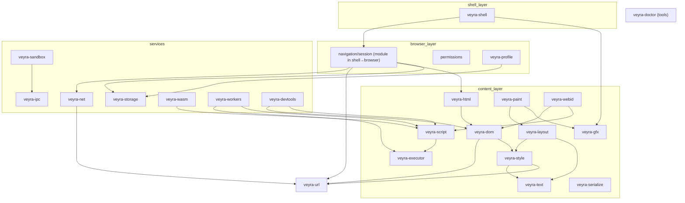

# Veyra Dependency Graph

status: Updated (Phase 1) | last-updated: 2026-10-15 | companion-to: system-overview.md

This document defines the **allowed dependency directions** between Veyra
crates and the invariants that keep them honest. It is the contract CI and
review enforce as crates appear; the graph below is the target state at
Phase 8. Current tree (Phase 1): `veyra-doctor` (tooling), `veyra-gfx`
(CPU raster), `veyra-shell` (application root).

## 1. Engine-crate dependency rules

Invariants (checked in review; a `veyra-doctor` extension will check them
mechanically once `Cargo.toml` edges exist):

1. **No cycles.** The content layer is a DAG ending in `veyra-paint`.
2. **`veyra-dom` depends on nothing in the engine** except `veyra-url`
   (origins live on nodes) — it is the system's stable core.
3. **`veyra-script`/`veyra-webid` are the only crates that see JS engine
   types.** Web API implementations elsewhere are engine-agnostic.
4. **`veyra-net` and `veyra-storage` never import content-layer crates.**
   They are trusted-service side; content reaches them only via
   capability-passing interfaces (security model §3).
5. **`veyra-url` is the only URL parser.** Everything else calls it
   (mirrors the Chromium centralized-URL finding, dossier networking §2).
6. **Untrusted-input leaf rule:** `veyra-html`, CSS parsing (in
   `veyra-style`), decoders, and IPC message decoding are leaf-ish crates
   with no privileged imports — they are the fuzz targets.
7. **`veyra-shell` is a root** (nothing depends on it). In Phase 1 the
   shell consumes `veyra-gfx` through the [`RasterSurface`] trait only —
   the same seam the Phase 7 GPU backend plugs into (ADR-0005).

[`RasterSurface`]: https://docs.rs/veyra-gfx

## 2. External dependencies (target state)

Consolidated from the dependency audit; each row's adoption is phase-gated:

| Area | Crates | Notes |
|---|---|---|
| URL | url, idna | adopted Phase 2 |
| Async/runtime | tokio | services only |
| HTTP/TLS/DNS | hyper, h2, rustls, rustls-platform-verifier, hickory-resolver | Phase 2 |
| HTML | html5ever | Phase 2 (ADR-0003) |
| Text | parley, fontique, rustybuzz, ttf-parser, swash, fontdb, unicode-bidi, unicode-segmentation | Phase 3 |
| CSS/layout | cssparser/selectors (MPL gate) or stylo; taffy | Phase 3 (ADR-0003) |
| Graphics | tiny-skia; wgpu; (vello eval) | Phase 3/7 (ADR-0005) |
| SVG/images | resvg/usvg, image | Phase 7 |
| JS | boa_engine | Phase 4 (ADR-0002) |
| WASM | wasmi; wasmtime later | Phase 8 (ADR-0009) |
| Storage | redb | Phase 6 (ADR-0010) |
| IPC/sandbox | interprocess, nix, landlock, seccompiler | Phase 6 |
| A11y/OS | accesskit, keyring | Phase 10 |
| Tooling | tracing, criterion | ongoing |

Build-time policy: no build.rs network access; no proc-macro dependencies
in the content layer until the Phase 5 binding-generator decision.

## 3. Testing boundaries

- Unit tests live in-crate; integration tests per boundary in `tests/` of
  the owning crate; cross-crate determinism tests in `veyra-shell`'s
  harness (screenshot/display-list).
- Fuzz targets: `veyra-html` (bytes), `veyra-style` (CSS bytes),
  `veyra-url` (strings), `veyra-net` (response bytes), decoders (bytes),
  `veyra-ipc` (message bytes), `veyra-serialize` (value bytes).
- The dependency graph is what makes this tractable: leaf parsers cannot
  hide behavior behind service calls, so their tests are complete.

## 4. Phase-gate additions

Crates join this graph only at their roadmap phase, with the ADR that
justifies the boundary cited in the crate's `Cargo.toml` header comment.
The current tree contains `veyra-doctor`, `veyra-gfx` (Phase 1, brought
forward per roadmap — ADR-0005/0012), and `veyra-shell` (Phase 1,
ADR-0007/0012); every other row in §1's diagram is a target state, and
the review checklist rejects PRs that add crates without both the
roadmap phase and an ADR reference. When a boundary
turns out wrong in practice (cohesion signals: types imported solely to
satisfy visibility, cyclic test helpers, duplicated data structures),
the correction is an ADR amendment plus a re-draw of this document —
not a quiet merge of crates.

## 5. External-crate isolation rules

Every external dependency is consumed through a Veyra-owned wrapper
type or module at exactly one boundary, so that replacement remains a
local change:

| External surface | Isolating boundary | Rule |
|---|---|---|
| `url`, `idna` | `veyra-url` | no other crate may call URL parsing |
| `hyper`/`h2`/`rustls`/`quinn` | `veyra-net` internals | transport types never appear in public APIs |
| `html5ever` | `veyra-html` | emits `veyra-dom` nodes only |
| `boa_engine` | `veyra-script` | engine types never leave the facade (ADR-0002) |
| `wgpu`/`tiny-skia`/`vello` | `veyra-gfx` | device/queue types never leave the trait |
| `redb` | `veyra-storage` | database handles are crate-private |
| `parley`/`rustybuzz`/`swash` | `veyra-text` | shaped-run types are internal |
| `tokio` | services only | engine core stays synchronous |

This is what converts "dependency risk" into "one-file swap": the audit
table's candidates can be re-evaluated without cascading changes.
