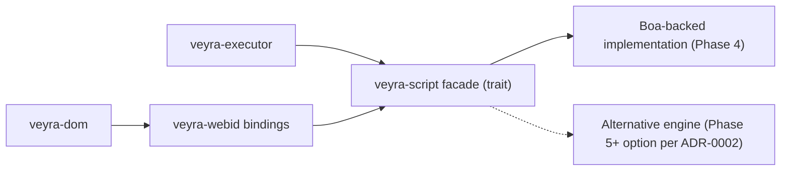

# Veyra Execution and Web APIs

status: Proposed (Phase 0) | last-updated: 2026-10-15 | derived-from: ../research/javascript-and-wasm.md

How Veyra executes script and exposes Web APIs. The controlling principle:
**the JS engine is a replaceable component behind a facade**, and the Web
API surface is pure Rust reachable only through a binding layer.

## 1. Event loop (veyra-executor)

Spec-shaped [ST1], not a tokio assumption:

- Task queues per task source with ordering rules; microtask checkpoint
  points exactly where the HTML spec places them (after script.stack
  unwinds, before rendering updates).
- Rendering opportunities: rAF callbacks aligned to an injectable frame
  clock (headless tests drive frames manually — determinism).
- Timers with spec delay/clamping semantics and injectable clock.
- Owned execution model: engine logic is synchronous between event-loop
  steps; async I/O (network) posts completion tasks back to the loop.

Tests: microtask-ordering suites, timer semantics suites (WPT
html/timers-class), rAF ordering. Injectable clock makes them deterministic.

## 2. JS engine facade (veyra-script)

Facade responsibilities: realm/context creation, evaluation, module
loading integration, microtask draining callback, exception capture with
stack details, rooting protocol for DOM wrappers, debug hooks (pause/
breakpoint callbacks — Phase 4 stub, Phase 9 full), and the `$262`-class
test hooks.

**Engine choice:** Boa [E: active, permissive, self-reported >90%
ECMAScript] as the Phase 4 implementation (full reasoning, alternatives,
and revisit metrics in [ADR-0002](../decisions/0002-javascript-engine-strategy.md)).
**No V8-class performance is promised**; Phase 4 targets: language
sufficient for WPT testharness execution and core API tests, with measured
Test262 results published in the compatibility matrix.

## 3. Ownership and GC interop (the hard part)

Rust DOM (`veyra-dom` arena, generational indices) + tracing-GC JS heap
must coexist:

- **JS → DOM:** every JS-visible DOM object is a wrapper holding an
  (arena, index) reference; wrappers are GC roots registered with the
  engine; finalizers release wrapper registrations only.
- **DOM → JS:** callbacks/listeners/handlers stored in the DOM are opaque
  engine values; the DOM notifies the engine before dropping them
  (release notification), so the GC collects.
- **No engine types leak** past `veyra-script`/`veyra-webid` — Web API
  implementations take/return plain Rust types. This is what makes an
  engine swap survivable (ADR-0002's purpose).
- Cycle risk (JS object ↔ DOM node) is broken by GC-side wrapper tracing:
  the facade exposes a trace callback so the engine's collector walks DOM
  registrations. Design spike scheduled at Phase 4 entry (open question in
  the research dossier).

## 4. Binding layer (veyra-webid)

Phase 4: hand-written bindings for the curated core set (documented
list): window/document/node basics, events, element attributes/queries,
DOMTokenList, forms basics, location/history (browser-module backed),
fetch (Phase 5), storage (Phase 6), timers/console. Phase 5 decision:
introduce a proc-macro IDL generator once >50 interfaces (per
[`../research/javascript-and-wasm.md`](../research/javascript-and-wasm.md) §7).
Semantics per Web IDL [ST7]: conversions, exceptions, `this` handling,
dictionaries, sequences, promise integration with the executor.

## 5. Structured clone and messaging

`veyra-serialize` implements the structured-clone algorithm [ST2/HTML] —
value graph walk with cycle handling, platform objects (ports, blobs)
handled by registry — used by postMessage (Phase 5), workers (Phase 8),
IndexedDB values (Phase 6). Pure Rust, table-driven, fuzz-target.

## 6. WebAssembly (veyra-wasm, Phase 8)

Runtime: `wasmi` (interpreter) first, `wasmtime` when JIT/performance work
is justified — full decision in [ADR-0009](../decisions/0009-webassembly-runtime.md).
The `WebAssembly` JS API [J6] is implemented in `veyra-webid` over the
runtime: Module/Instance/Memory/Table/Global, streaming compile over the
fetch pipeline, validation errors surfaced per spec. Spec conformance tests
from the WASM suite run against the runtime; JS-API tests via Test262's
wasm staging when engine support permits.

## 7. Workers (Phase 8)

Dedicated workers first: own event loop instance (executor is
instantiable), own global scope, MessagePort pairs with structured clone;
same-origin script fetch. Shared workers and service workers follow with
the storage/lifecycle machinery (Phase 8+, service workers gated on the
storage partition work from Phase 6 — recorded dependency in the roadmap).

## 8. Debugging and diagnostics hooks (Phase 4 stubs → Phase 9)

Breakpoint/pause callbacks in the facade; CDP-shaped protocol subset in
`veyra-devtools` (Runtime, Debugger, DOM, Network first) — see
[`../research/browser-product-features.md`](../research/browser-product-features.md)
§3 for the frontend-strategy open question.

## 9. Open questions

1. Boa rooting/trace API fit for §3's protocol (spike, Phase 4 entry).
2. Module resolution + fetch integration order (spec vs engine assumptions).
3. Performance envelope of facade indirection — measure at Phase 5 with
   benchmarks before optimizing (no premature inlining of engine internals).
4. Realm model depth (separate globals per frame vs shared heap) — affects
   site-isolation V2; decision with Phase 6 process work.
