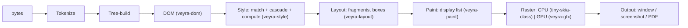

# Veyra Rendering Pipeline

status: Proposed (Phase 0) | last-updated: 2026-10-15 | derived-from: ../research/web-platform-and-rendering.md

Veyra's rendering design, derived from the RenderingNG research (dossier §6)
and the correctness argument recorded there. This document fixes the
*structures and invariants*; algorithm detail evolves per phase.

## 1. The pipeline and its stages

Stage contracts (each stage owns a cache and a dirty-bit protocol):

| Stage | Input → Output | Invalidation input | Cache |
|---|---|---|---|
| Parse | bytes → DOM | none (one-shot per document load) | — |
| Style | DOM + stylesheets → computed styles per element | DOM mutations, stylesheet changes | rule maps, invalidation sets |
| Layout | computed styles → box tree fragments | style changes, viewport | per-format-context caches, intrinsic sizes |
| Paint | fragments → display list | layout changes, style paint-affecting changes | display list per stacking context |
| Raster | display list → pixels | display list changes | tiles (GPU path), buffers (CPU) |

**Invariant R1 (incremental correctness):** a mutation invalidates the
minimum set of downstream work through explicit dirty-bit propagation; the
acceptance tests for Phases 3+ are *mutation sequences*, not just initial
renders (see dossier §6 for why naive full-recompute fails real sites).

**Invariant R2 (paint order):** display-list construction follows the CSS
paint order (stacking contexts, positioned elements, opacity groups,
filters) per compositing spec [ST23] — never document order.

**Invariant R3 (axis abstraction):** layout is written in logical axes
(block/inline) with writing-mode mapping from day one [ST37]; physical
coordinates appear only at paint/raster. Retrofitting logical axes is a
rewrite; this invariant prevents that.

**Invariant R4 (origin awareness):** every frame/document carries its origin
from Phase 2 so site-isolation deployment (Phase 6+) and cross-origin
rendering policy (e.g., cross-origin iframe paints are clipped/blinded
until isolation exists) are policy, not surgery.

## 2. Text and fonts

`veyra-text` owns the text stack (ADR-0015, as superseded in part by
ADR-0016): harfrust shaping (the HarfBuzz-org Rust port — GSUB/GPOS,
verified against the bundled faces with golden constants identical to
the rustybuzz era) over read-fonts font data (the fontations parse
foundation harfrust itself builds on), unicode-bidi for UAX#9
levels/visual runs, and unicode-segmentation for UAX#29 boundaries —
all behind Veyra-owned types so shaper churn stays in one crate. Font
collection is explicit
(the embedded default set — bundled DejaVu faces — plus loaded
sources); parley (a paragraph layout engine, which would duplicate the
custom IFC) and fontique (system enumeration + fallback breadth) are
deferred with recorded rationale. Determinism rules for tests: a pinned
bundled font set for fixtures (platform font discovery disabled in test
mode); rasterization identical across runs (no subpixel randomness). Full
CSS Text line-breaking (UAX#14 via css-text) and vertical writing are
Phase 7; the axis abstraction (R3) is Phase 3.

## 3. Layout strategy

- **Block + inline (Phase 3):** custom implementation — no adequate Rust
  crate exists (dossier gap table); BFC/margin-collapsing per [ST14],
  inline layout with text runs from veyra-text. Intrinsic sizing (min/max-
  content) implemented as a layout *mode* from the start.
- **Flexbox + Grid (Phase 3/7):** `taffy` [E, MIT] provides the algorithms;
  Veyra supplies the interface layer (computed-style → taffy input) and
  fragment extraction. Risk: taffy's intrinsic-sizing fidelity for complex
  interop — tracked as ADR-0003 revisit condition.
- **Tables (Phase 5+):** fixed layout first, auto layout later; fragmentation
  (multicol/print) Phase 7+.
- **Positioned/stacking (Phase 3 minimal, Phase 7 full):** containing-block
  chains and stacking-context tree as first-class structures feeding both
  paint order (R2) and hit testing.

## 4. Paint, raster, compositing

**Phase 3 (CPU path):** display list → `tiny-skia`-class rasterization into
an ARGB buffer; screenshot harness consumes it (determinism by construction
— no GPU in the loop). This is the golden-image test substrate.

**Phase 7 (GPU path):** `veyra-gfx` over `wgpu` [E, MIT OR Apache-2.0];
compositing with property trees (transform/clip/effect/scroll nodes — the
RenderingNG shape, dossier §6) enabling compositor-side scrolling;
candidate vector path: `vello` [E] evaluation vs custom tessellation; text
atlas via glyphon-class rasterization. Decision recorded in ADR-0005 with
revisit conditions.

**Damage tracking:** CPU path invalidates whole frame initially (fine for
diagnostic use), gains rect-based damage in Phase 5; GPU path is
tile-based from adoption.

## 5. SVG, canvas, images (Phase 7)

SVG via `resvg`/`usvg` integration [E] into the display list (SVG becomes
paint commands, not an offscreen image, where interactivity requires);
Canvas 2D as a retained-state immediate-mode surface with CPU backing
first; image decode via `image` crate with orientation/color-space
handling; AVIF gap recorded (dossier dependency audit §8) — not hidden.

## 6. Hit testing and input

Input flows: shell → event loop (Phase 4) → hit test against the box tree +
property trees (scroll/clip/transform) → DOM event dispatch [ST2]. Hit
testing is a paint-adjacent walk — implemented against the same structures
so that scroll/transform semantics cannot diverge between visual and
interactive behavior.

## 7. Testing surface

- Golden-image screenshot harness (Phase 1 exit criterion) with pinned
  fonts and fixed viewport.
- Display-list snapshot tests (assert the *list*, not pixels — catches
  paint-order regressions textually).
- Mutation-sequence layout tests (R1) and paint-order unit tests (R2).
- WPT reftests once two rendering paths exist for comparison (Phase 5+,
  method in [`../research/testing-and-performance.md`](../research/testing-and-performance.md)).

## 8. Open questions

1. vello readiness for browser-grade 2D (performance + text) — ADR-0005
   spike at Phase 7 entry.
2. Scroll-linked effect semantics (sticky, scroll-driven animations) on the
   compositor path — design with property trees, implement Phase 7+.
3. Cross-process frame compositing (site isolation V2) — deferred; property
   tree design keeps the door open (R4).
4. HDR/wide-gamut color management scope — Phase 10 (CSS Color 4 parsing is
   Phase 7; monitor profile handling is later).
