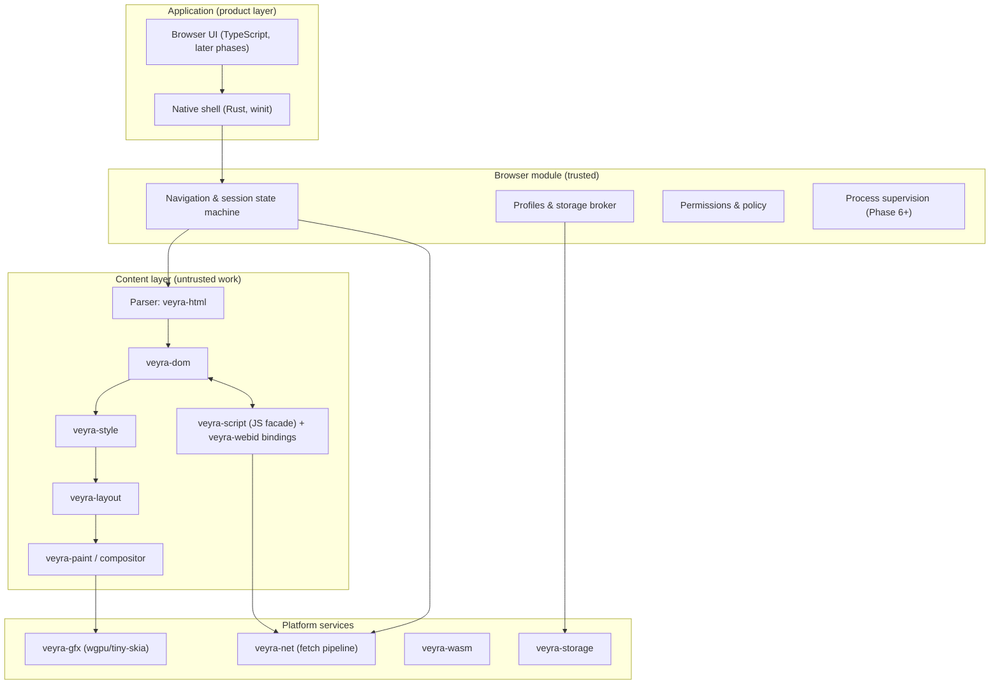

# Veyra System Overview

status: Proposed (Phase 0) | last-updated: 2026-10-15 | derived-from: ../research/

This document describes **Veyra's proposed** architecture — a design
informed by the Chromium research dossier, not a description of implemented
code. Every subsystem below has a phase in
[`../roadmap/implementation-plan.md`](../roadmap/implementation-plan.md);
nothing exists until its phase's acceptance criteria pass.

## 1. Design goals (in priority order)

1. **Correctness over coverage** — a smaller set of behaviors that are
   spec-exact beats a large set that is approximated.
2. **Security by construction** — trust boundaries and capability-passing
   are structural (types and module boundaries), not conventions.
3. **Determinism by default** — every engine input is injectable (clock,
   RNG, font set, viewport) so behavior is reproducible and testable.
4. **Incremental honesty** — the compatibility matrix reflects reality;
   partial support is labeled partial.
5. **Rust-first, dependency-frugal** — see
   [`../research/dependency-and-license-audit.md`](../research/dependency-and-license-audit.md);
   every dependency is phase-gated and ADR-recorded.

## 2. Top-level decomposition

## 3. Crate strategy (boundaries, not bloat)

The workspace starts with **one crate** (`veyra-doctor`, tooling) and adds
engine crates only at ADR-justified boundaries. Planned crates and the
reason each deserves a boundary:

| Crate | Boundary justification | Phase |
|---|---|---|
| `veyra-doctor` | Repository tooling; independent of engine | 0 (exists) |
| `veyra-url` | Single security-critical URL/origin authority; no other crate may parse URLs | 2 |
| `veyra-html` | Untrusted-input boundary; fuzz target; isolates parser | 2 |
| `veyra-dom` | Core data structure; depended on by everything; depends on nothing | 2 |
| `veyra-net` | Trust boundary (process split target); owns fetch/cookie/cache policy | 2 |
| `veyra-style` | CSS cascade/computed values; heavy caches | 3 |
| `veyra-layout` | Layout algorithms + intrinsic sizing | 3 |
| `veyra-text` | Shaping/fonts/bidi; isolates text-stack churn | 3 |
| `veyra-paint` | Display lists, invalidation | 3 |
| `veyra-gfx` | Device abstraction (CPU raster now, wgpu later) | 3 |
| `veyra-executor` | Event loop, timers, microtasks; injectable time | 4 |
| `veyra-script` | JS engine facade (engine-swappable) | 4 |
| `veyra-webid` | Web IDL binding layer; keeps engine types out of Web APIs | 4–5 |
| `veyra-serialize` | Structured clone and value serialization (postMessage/IndexedDB) | 5 |
| `veyra-ipc` | Message definitions/transport for trust boundaries | 6 |
| `veyra-storage` | Origin/partition-keyed persistence | 6 |
| `veyra-sandbox` | OS sandbox integration | 6 |
| `veyra-wasm` | WASM runtime + JS API | 8 |
| `veyra-workers` | Worker event loops/lifecycles | 8 |
| `veyra-shell` | Window, input, screenshot harness (the Phase 1 executable) | 1 |
| Product crates (browser UI host, devtools) | Phase 9–10; boundaries decided then | 9–10 |

Rule: a crate exists when it has (a) a distinct trust or caching boundary,
(b) a dependency-direction constraint worth enforcing, or (c) a fuzz target
that needs isolation. Otherwise it is a module inside an existing crate.

## 4. Cross-cutting rules

- **Dependency direction**: `dom` ← `style` ← `layout` ← `paint`; `script`
  and `net` depend on `dom` but never the reverse; nothing depends on
  `shell`. The full graph with invariants lives in
  [`dependency-graph.md`](dependency-graph.md).
- **Errors**: typed errors per crate; no panics on untrusted paths
  (workspace `unwrap_used`/`expect_used`/`panic` deny lints).
- **Async**: tokio is allowed in services (`net`, `ipc`, `shell`); the
  engine core (`dom`/`style`/`layout`/`paint`) is synchronous with explicit
  stepping so the event loop owns scheduling deterministically.
- **Configuration**: one config schema owned by `veyra-shell` from Phase 1;
  reserved for enterprise policy extension later.
- **Observability**: `tracing` spans with an engine-wide span taxonomy;
  no page-content in logs by default (privacy rule in engineering standards).

## 5. What is deliberately not decided yet

Recorded as open decisions with revisit triggers in
[`decision-log.md`](decision-log.md): final GPU pipeline (vello vs custom
compositor), extension API surface, IPC wire format details, DevTools
frontend strategy, media strategy. Premature commitment here would be
architecture theater; the phases force evidence before decisions.
