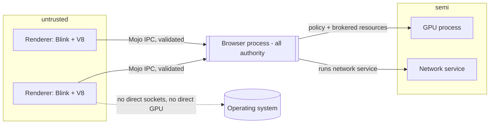

# Research: Chromium Browser Architecture

status: Investigated (first pass) | last-updated: 2026-10-15 | maintainer: foundation work

## Evidence basis

Primary: Chromium design documents — multi-process architecture [D3], site
isolation [D4], process model & site isolation docs [D7 — 503 at access time,
treated as unverified], Mojo & services [D6], network service [N3], sandbox
design [S2][S3]. Source organization claims (directory layout of
`content/`, `third_party/blink/`, `v8/`) are corroborated by the verified
READMEs [B2][B3][B4][N2][N3] and googlesource root [D1]. Most behavioral
detail below is `[K]` — established, documented behavior cross-checked against
the listed docs — pending a source-level pass recorded in the coverage matrix.
No claims in this document rest on line-level source citations, and none
should until that pass happens.

## 1. Why the process architecture exists

Chromium's defining architectural decision (from the original multi-process
design [D3]) is that the web is **hostile input**: arbitrary pages run code in
renderers, so renderers are treated as compromised. The architecture answers
three requirements that a single-process design cannot:

1. **Fault isolation** — a crashed renderer (buggy JS, OOM, engine bug) must
   not take down the browser or other tabs.
2. **Privilege separation** — code that renders web content must not hold
   filesystem, network-socket, or OS authority. All authority lives in the
   browser process, which arbitrates every renderer request.
3. **Origin isolation** — pages from different sites must not share address
   space, so CPU-level attacks (Spectre-class) and memory-safety bugs cannot
   leak cross-origin data. This is the site-isolation program [D4].

**Assessment for Veyra:** these three requirements, not any specific Chromium
mechanism, are what Veyra must reproduce. The mechanisms (Mojo, zygotes,
Seatbelt profiles) are means; the ends are: untrusted code runs with no
ambient authority; every cross-boundary request is brokered, validated, and
attributable to an origin; a renderer death is a recoverable UI event.

## 2. The process constellation

Chromium runs a constellation of process types [D3][K]:

| Process | Trust level | Core responsibilities |
|---|---|---|
| **Browser** | Full authority | UI, tab/window model, navigation control, network orchestration, storage, profile data, GPU policy, child-process lifecycle. The only process that talks to the OS broadly. |
| **Renderer** | Untrusted | HTML parsing, DOM, CSS/style/layout, JS execution, canvas drawing commands, V8. Sandboxed: no filesystem or network sockets; all I/O brokered. |
| **GPU** | Semi-trusted | Rasterization, compositing, GL/Vulkan command execution, display output. Receives validated command buffers. |
| **Utility** | Varies | Short-lived single-purpose services (network service, audio service, storage service, crash reporter). Move privileged work out of the browser process to shrink its trusted computing base. |
| **Zygote** (Linux/Android) | Helper | Pre-forked template process; children inherit initialized state for fast spawn and sandbox inheritance. |

**Observation [K]:** the network stack moved into a sandboxed utility process
("network service") — services/network per [N3] — and Chrome continued
migrating subsystems (audio, storage) into utility processes to shrink the
browser process. The direction of the architecture is "smaller trusted core".

**Mermaid sketch of trust edges:**

**Assessment:** Veyra's long-term shape is the same constellation; the
short-term shape (single process with enforced internal boundaries) is decided
in [ADR-0004](../decisions/0004-process-model.md) with the explicit condition
that the internal API surface must be message-shaped so that the split does
not require a rewrite.

## 3. Mojo: the IPC substrate

Chromium's inter-process communication is Mojo [D6]: an interface-definition
language (`.mojom` files), generated bindings, and a message-passing runtime
over named platform channels. Properties that matter for Veyra:

1. **Typed interfaces.** Every cross-process call is a declared interface with
   versioned messages — not ad-hoc serialized structs. The browser cannot be
   confused about what a renderer may call; the interface set *is* the attack
   surface.
2. **Handles, not pointers.** Resources (shared memory, data pipes, other
   interface endpoints) travel as transferable handles. There is no shared
   mutable object graph across the trust boundary.
3. **Synchronous and asynchronous paths** coexist; sync IPC is discouraged on
   the critical path because it converts a renderer stall into a browser stall.
4. **Receiver/binder pattern** ties an interface endpoint to a specific
   process/context, so origin attribution is explicit at the binding layer.

**Assessment:** Veyra should adopt the *discipline* (IDL-declared, versioned,
capability-typed messages between trust boundaries) without Mojo's
implementation. In Rust this maps naturally to enum-of-messages + typed
channels over `interprocess` local sockets or anonymous pipes; a Rust IDL
approach can start as a hand-written message module per boundary. The rule
that matters: **no cross-boundary API that isn't a declared message.**

## 4. Site isolation

Site isolation [D4] assigns renderers per **site** (scheme + eTLD+1), not per
tab. Consequences:

- A page embedding cross-site iframes gets its subframes in **out-of-process
  iframes (OOPIF)** [D5 — unverified at access time; behavior documented in
  site-isolation docs], with the frame tree spanning processes.
- Isolation extensions: origin-keyed isolation for high-risk origins,
  isolation of `file://` URLs, and related-web-site exceptions
  (storage access, first-party sets) loosen it deliberately [K].
- Cost: multi-process memory overhead, cross-process layout/imaging
  coordination, and hit-testing across process boundaries — the price Chrome
  accepted for the security benefit.

**Assessment:** Veyra cannot start with full site isolation (the frame-tree
machinery is enormous), but must never *paint itself into a corner*: the
rendering pipeline must treat "which origin owns this frame" as a first-class
input from the start, so that a later per-site split is a deployment change,
not an engine redesign. This constraint is written into the rendering
pipeline design ([../architecture/rendering-pipeline.md]).

## 5. Navigation and document lifecycle

The navigation flow [K, corroborated by D3/D6/D7 docs listed]:

1. UI or script initiates navigation; the **browser process owns the decision**
   (it must, to enforce URL/security policy before any network access).
2. The browser network stack fetches; redirects are re-evaluated for
   cross-origin process placement.
3. A **speculative renderer** may be pre-created ("speculative renderer")
   during network fetch to overlap process spin-up with transfer time.
4. The renderer parses and renders; on commit, the browser swaps the frame's
   association to the new document.
5. The old document enters back/forward cache retention (bfcache) or is
   destroyed; unload semantics (and their notorious reliability) are part of
   the HTML spec's navigation algorithm [ST1].

Document lifecycle states [K]: a document can be **active**, **cached
(bfcache)**, **prerendering/activating**, or **frozen** (page lifecycle API).
Renderers can also be **killed on resource pressure** with tab-level
discarding in the browser. Crash recovery maps a dead renderer back to a
reloadable tab state.

**Assessment:** navigation-as-browser-state-machine is the single most
valuable Chromium pattern for Veyra to copy conceptually: the browser process
(or, in Phase 1–5, the browser module) owns a navigation state machine whose
inputs are UI intents, script navigations, and network events — never raw
renderer writes. This is where URL security, history, session restore, and
process placement all converge.

## 6. Frame ownership and the frame tree

Frames form a tree (main frame → iframes → …) that spans processes under site
isolation: local frames in "their" renderer; remote frames as proxies [D4][K].
Ownership implications:

- **Browsing contexts** (window, iframe) are spec objects [ST1][ST2];
  Chromium tracks them as `FrameTree` nodes with local/remote variants.
- **Cross-process events** (input, focus, hit-testing) are routed through the
  browser process to the right renderer.
- **Rendering synchronization** across OOPIF boundaries is one of the hardest
  subsystems (compositor ownership across processes) — see
  [web-platform-and-rendering.md](web-platform-and-rendering.md).

**Assessment:** Veyra Phase 2–5 targets a single-process, single-site world;
the DOM design must still model browsing contexts and document ownership per
spec so that multi-frame documents (same-process iframes) work before
cross-process frames are attempted.

## 7. Scheduling, background work, resource management

Chromium runs per-renderer schedulers aligned to the compositor's begin-frame
clock, plus browser-side task queues for UI, IO, and navigation [K]. Key
mechanisms documented in the web-platform docs: requestAnimationFrame
alignment, page lifecycle freezing of background pages, tab discarding under
memory pressure, and render-process priority management by the browser.

**Assessment:** Veyra's event loop (Phase 4) must implement the HTML event
loop semantics (task queues, microtask checkpoints, rAF) [ST1] as its own
scheduler abstraction — not a bare tokio runtime assumption — because
deterministic testing (see [testing-and-performance.md](testing-and-performance.md))
requires an injectable frame clock.

## 8. Startup, shutdown, and session restore

Chromium parallelizes startup (prefetch, preloading, zygote pre-fork, deferred
non-critical service init) and restores sessions by reissuing navigations or
restoring from serialized tab state [K]. Profile lifecycle (open/close,
deletion, locking) is browser-process work tied to the user-data-dir layout
(see [networking-and-storage.md](networking-and-storage.md)).

**Assessment:** startup performance work belongs to Phase 10; the only
Phase 1–2 requirements are: configuration loading, a session/state file
format designed to be crash-safe from the start (write-temp-then-rename), and
measurement hooks.

## 9. What Veyra needs to reproduce (capability checklist)

| Chromium capability | Veyra requirement | Phase |
|---|---|---|
| Browser-owned navigation state machine | `veyra-shell`/browser module owns navigation; renderers never navigate directly | 2 |
| Message-only trust boundaries | Declared message enums per boundary; no shared mutable state across boundaries | 2 onward |
| Renderer untrusted by design | No ambient authority in renderer-reachable APIs; brokered I/O | 6 (design from 1) |
| Site isolation | Origin tags on all frames/resources from day 1; process split later | 6+ |
| GPU process | Out-of-process raster/compositing after in-process pipeline works | 7+ |
| Utility services | Network/storage/audio as separable services with message APIs | 6–8 |
| Crash recovery | Renderer-death maps to recoverable tab state | 6 |
| Session restore | Crash-safe session file; write-temp-then-rename | 2 |

## 10. Open questions

1. **[U] Exact current IPC surface inventory.** The full set of Mojo
   interfaces exposed to renderers defines Chromium's true attack surface;
   cataloguing it is a follow-up research task (priority: high, before Phase 6).
2. **[U] Speculative-renderer details and modern startup path.** Public docs
   describe the mechanism; the current implementation details (thresholds,
   preconnect behavior) need a source-level pass.
3. **[U] Bfcache retention policies and heuristics** as currently shipped —
   documented in blog posts and spec discussions; a precise behavioral spec
   citation is pending.
4. **[U] Frame-tree internals under OOPIF** — hit-testing and input routing
   across processes is documented at design level only.
5. **How far can a Rust design share Chromium's shape before cost dominates?**
   Chromium's constellation exists at Chrome's scale; Veyra must find the
   point where process count stops paying for itself. This is a live
   architectural question recorded in ADR-0004.

## Confidence and gaps

- High confidence: the roles/trust split of process types, the existence and
  role of Mojo, site isolation's goals and per-site renderer assignment,
  browser-owned navigation — all directly documented [D3][D4][D6].
- Medium: lifecycle minutiae (bfcache, freezing), scheduling internals [K].
- Low / pending: any statement about specific source files, thresholds, or
  current implementation details — deliberately absent; the coverage matrix
  lists "read navigation/content-layer source" as the next research task.
