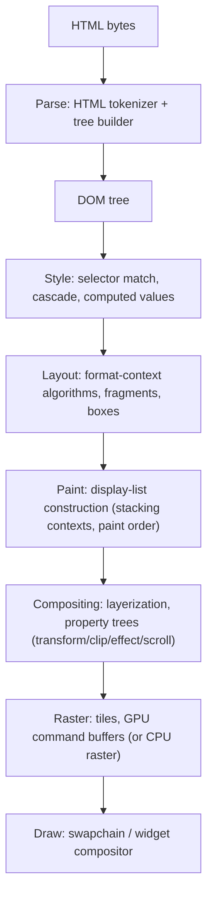

# Research: Web Platform, Rendering Pipeline (HTML, DOM, CSS, Layout, Paint)

status: Investigated (first pass) | last-updated: 2026-10-15 | maintainer: foundation work

## Evidence basis

Standards: WHATWG HTML (incl. parsing algorithm, event loop, browsing
contexts) [ST1], DOM [ST2], CSS Cascade 5 [ST12], Selectors 4 [ST13], Display
[ST14], Flexbox [ST21], Grid [ST22], Color 4 [ST25], Writing Modes [ST37],
Compositing [ST23], CSS Text [ST49], Unicode Bidi UAX#9 [ST18], Line Breaking
UAX#14 (referenced via CSS Text) [U]. Chromium: Blink DOM README [B2], layout
README [B3], CSS README [B4] — all verified reachable; RenderingNG
architecture [D8, verified at developer.chrome.com/docs/chromium/renderingng];
GPU compositing design doc [D13]. Rendering pipeline detail is `[K]`
cross-checked against RenderingNG docs; layout algorithm internals are `[K]`
with a source-level pass pending (see coverage matrix).

## 1. HTML parsing: bytes → tree

The WHATWG HTML parsing algorithm [ST1] is the contract every browser must
implement. Properties Veyra must reproduce exactly:

1. **State-machine tokenization** over a byte stream (with encoding detection
   per [ST6] and BOM/preprocessor handling). Tokenization states cover
   character references, attributes, doctypes, CDATA in foreign content.
2. **Tree construction with error recovery.** "Malformed" HTML has specified
   behavior: the stack of open elements, insertion modes, implied end tags,
   foster parenting (mis-nested table content migrates before the table),
   and the adoption agency algorithm (mis-nested formatting elements like
   `<b><i></b></i>` get restructured). Real-world pages depend on all of it.
3. **Scripting integration points.** Parser-blocking scripts, `defer`/`async`,
   `document.write` re-entrancy, custom element upgrade ordering — parsing
   and scripting are interleaved, not sequential phases.
4. **Fragment parsing** (innerHTML etc.) with a context element, and
   **foreign content** (SVG/MathML) switching between tokenization rules.

**Failure modes to engineer against:** unbounded attribute/tag nesting
(recursion must be iterative or depth-limited), multi-megabyte attributes
(memory limits), adversarial character references (unbounded entity decoding),
and parser-bomb documents (the classic 10×-per-level expansion). All are
fuzzing targets from Phase 2 (see [testing-and-performance.md](testing-and-performance.md)).

**Veyra candidates [E]:** `html5ever` (Servo) is a mature spec-compliant
implementation of this exact algorithm (license MIT OR Apache-2.0, active);
`html5gum` is a lighter alternative (MIT). Assessment: adopt html5ever's
*tokenization/tree-construction behavior* as the reference; ADR-0003 records
whether Veyra adopts the crate or reimplements with it as the test oracle
(html5lib-tests, MIT-licensed, is the shared test corpus either way [E:
html5lib/html5lib-tests, MIT, active]).

## 2. DOM: tree, mutation, and lifecycle

The DOM standard [ST2] defines: the node tree; **mutation algorithms**
(insert/replace/remove with their pre-removal steps); **custom elements**
(definition, upgrade, connected/disconnected callbacks); **shadow DOM**
(trees, boundaries, composed events, slots and flattened-tree assignment);
**ranges and selection**; **event dispatch** (capture/target/bubble,
propagation path computation, listeners, default actions); **MutationObserver,
IntersectionObserver, ResizeObserver**; and the DOM of **templates**
(`template` contents as a separate document fragment).

**Observations that shape Veyra's design [K]:**

- The "flattened tree" (light DOM + slots + shadow trees composed) is the
  tree that *rendering and hit-testing* walk; the "composed path" is the tree
  that *events* walk. Getting these two views consistent is a known-hard part
  of any engine.
- Weak references and observability: MutationObserver callbacks fire at
  microtask checkpoints [ST1]; observers must not leak or re-entrantly mutate.
- The DOM is **retained and queryable** in ways that resist naive GC: every
  node is reachable from JS and from layout simultaneously.

**Veyra approach (assessment, detailed in [ADR-0003](../decisions/0003-rendering-architecture.md)):
an owned, arena-backed DOM tree (`veyra-dom`) with generational indices, and
script-side wrappers kept alive by the JS engine's GC with explicit rooting.
Mutation observation is a subscription list processed at microtask
checkpoints — matching spec, testable deterministically.

## 3. Browsing contexts, sessions, and navigation surface

HTML spec [ST1] obligations: window/browsing-context relationships
(`window.opener`, named targets, `rel=noopener` semantics), the session
history model (joint session history, history traversal, scroll restoration),
beforeunload/unload constraints, and focus management. This surface is where
navigation (researched in [chromium-architecture.md](chromium-architecture.md))
meets spec-visible behavior; Veyra's Phase 5 exit criteria include the
navigation/history subset of WPT.

## 4. CSS: parsing → cascade → computed values

Pipeline stages [ST12][ST13][B4][K]:

1. **Tokenization/parsing** to declaration blocks and rules; `@media`,
   `@supports`, `@layer`, `@container` as conditional/group rules.
2. **Cascade**: origin & importance (user-agent < user < author, with
   `!important` inversion), **cascade layers** (`@layer` ordering), specificity,
   and order of appearance; **inheritance** and **initial/inherit/unset/revert
   values**; registered custom properties (`@property`) with typed animation.
3. **Computed values**: specified → computed (em → px resolution, keyword
   expansion) → used (layout-dependent) — the three-tier model that layout
   and paint read.
4. **Selector matching**: right-to-left matching with rule buckets keyed by
   id/class/tag; invalidation sets track which selectors depend on which
   attributes/classes so DOM mutations invalidate precisely.

**Observation [B4][K]:** Blink's style system maintains rule maps, computed
style objects (shared where possible), and **invalidation sets**; style
recalculation after a DOM change touches only subtrees the invalidation sets
mark. A full-tree recompute per mutation is performance-infeasible on real
sites.

**Veyra candidates [E]:** `cssparser` and `selectors` (Servo, MPL-2.0) and
`stylo` 0.22 (the extracted Gecko style engine, MPL-2.0, active). **Assessment:
stylo is the highest-leverage and highest-complexity option**; its MPL-2.0
license is file-level copyleft — acceptable only with an explicit ADR and
license hygiene (see [dependency-and-license-audit.md](dependency-and-license-audit.md)
and [ADR-0010](../decisions/0010-storage-engine.md) for the analogous storage
decision; the CSS decision is ADR-0003). Writing cascade+inheritance from
scratch on top of `cssparser`+`selectors` is the fallback, at real conformance
cost in year one.

## 5. Layout

CSS layout subsystems, each with its own model [ST14][ST21][ST22][ST37][K]:

| System | Model | Notes |
|---|---|---|
| Block flow | Boxes stacked in a block formatting context; margins collapse | Margin collapsing across BFC boundaries is a classic conformance swamp |
| Inline layout | Inline boxes, text runs, soft wrap opportunities, inline-axis alignment | The most text-i18n-heavy area; interacts with shaping (below) |
| Flexbox | 1-D main/cross axis, flexible lengths, intrinsic contributions | Ordering and min/max constraints are subtle; intrinsic sizing feeds grid/table |
| Grid | 2-D tracks, placement, subgrid | Track sizing algorithm is iterative with content-based minimums |
| Tables | Fixed and auto layout, anonymous boxes, spanning | Auto table layout is iterative and slow; historically a compat minefield |
| Positioned | Containing blocks, stacking contexts, transforms | Interacts with paint order and compositing |
| Fragmentation | Pagination, multicol, break properties | Needed for printing; multicol interacts with all of the above |

**Intrinsic sizing** (min/max-content) is a *second* layout pass dimension
that flexbox/grid/table all consume; engines implement "intrinsic width"
computation as a layout variant. **Assessment:** this is why layout is the
highest-risk subsystem in the roadmap — Veyra's Phase 3 deliberately starts
with block+inline (with `taffy` [E, MIT] providing flexbox/grid) and grows
coverage by WPT area, not by feature checklist.

**Text shaping and fonts:** shaping runs HarfBuzz-shaped algorithms (itemize
by script, shape runs, cluster maps) [K]; Veyra candidates: `harfrust` (the
HarfBuzz-org Rust port — adopted Phase 3 via ADR-0016, superseding the
rustybuzz candidate after RUSTSEC-2026-0192 declared it and `ttf-parser`
unmaintained; MIT), `swash` (scaling+rasterization), `parley`/`fontique`
(Linebender text stack: font enumeration, fallback, shaping orchestration,
Apache-2.0 OR MIT) [E]. Bidi reordering per UAX#9 [ST18] via `unicode-bidi`.
Fonts: SFNT parsing (`read-fonts`/`skrifa` — fontations), system font discovery (`fontdb`) with
platform-specific gaps (DirectWrite/CoreText/fontconfig) noted as native
integration points (see [ADR-0007](../decisions/0007-native-dependency-policy.md)).

**Writing modes & i18n:** vertical-rl/lr writing modes change the block/inline
axis definitions entirely; logical properties map to physical per writing mode.
Conformance here requires the axis abstraction to exist *from the first layout
code* — retrofitting logical axes is a rewrite. This is written into the
rendering pipeline architecture.

## 6. From pixels back to bytes: the full rendering pipeline

RenderingNG organizes the pipeline as [D8][D13][K]:

Key structures (documented in RenderingNG [D8]):

- **Display lists** are retained paint operations per fragment; paint
  invalidation regenerates *lists*, not pixels.
- **Property trees** (transform/clip/effect/scroll) factor hierarchical state
  so compositor-thread scrolling and animations can run without main-thread
  involvement — the reason modern Chrome scrolls smoothly while JS hogs the
  main thread.
- **Tiles and damage tracking** bound rasterization work to what changed.
- **Hit testing** walks the same property trees (scroll/clip/transform).

**Why naive implementations fail on real websites (assessment, the core
correctness argument):**

1. **Incremental updates.** A hover style, a single text edit, or a timer
   mutation must not relayout the document. Real sites mutate the DOM
   constantly (React/Fresh/etc. re-render at 60fps); only invalidation-driven
   incrementalism sustains interactive frame budgets. Correct incrementalism
   needs dirty-bit protocols at every stage boundary (style → layout → paint)
   — this is why Phase 3's acceptance criteria test *mutation sequences*,
   not just initial render.
2. **Stacking/paint order.** CSS paint order (positioned elements, z-index,
   opacity grouping, filters) is a specified ordering [ST23]; painting in
   tree order produces wrong pixels on nearly every styled page.
3. **Scrolling as a first-class citizen.** If scrolling requires main-thread
   layout, every scroll-while-JS-runs page janks. Compositor-driven scrolling
   is why property trees exist; Veyra's Phase 7 GPU path adopts the same
   shape (scroll nodes + transform tree) rather than a raster-everything
   model.
4. **Subpixel/zoom/device-scale consistency.** Text runs must rasterize
   identically across the animation of transforms; rounding rules live in
   the pipeline, not in each rasterizer call site.

## 7. Canvas, SVG, images

- **Canvas 2D** [K]: an immediate-mode drawing surface with its own retained
  state stack and path rasterization; acceleration strategies differ (GPU
  canvas vs CPU) but semantics are spec-stable. Veyra Phase 7: CPU-backed
  canvas via `tiny-skia`-class rasterizer first; GPU-backed later.
- **SVG** [K]: a document-format with its own layout (viewport/units, viewBox
  transforms) integrated into HTML via foreign content; text in SVG reuses
  the text stack. Veyra candidate: `resvg`/`usvg` [E, Apache-2.0 OR MIT] as
  SVG rendering engine — evaluated in ADR-0005 scope.
- **Images** [E]: decode pipeline with orientation, color space (ICC),
  animation; `image` crate covers PNG/JPEG/GIF/WebP basics; AVIF remains a
  gap (pure-Rust decoder ecosystem immature — recorded in the dependency
  audit as an open gap, not silently papered over with a C dependency).

## 8. Accessibility

Chromium constructs an accessibility tree in the renderer and projects it to
platform APIs (UIA/MSAA on Windows, AT-SPI on Linux, NSAccessibility on
macOS) [K, corroborated by WAI-ARIA mapping specs [ST17] — the mapping
standards themselves]. The tree is built lazily (on assistive-tech
attachment) and incrementally updated. **Veyra candidate:** `accesskit`
[E, MIT OR Apache-2.0, very active] provides exactly this renderer-tree →
platform-adapter abstraction; adopted as the design reference (ADR-0011
covers OS integrations). WAI-ARIA role/state mapping conformance is a
Phase 10 target with dedicated tests.

## 9. Printing, serialization, offscreen rendering

Printing = fragmentation to page boxes + PDF generation [K] (Chromium uses
Skia's PDF backend — a native dependency Veyra does **not** inherit; a
pure-Rust PDF writer is an open gap recorded in the dependency audit).
`outerHTML`/serialization [ST1], `innerHTML` fragment parsing, and
`screenshot`-style offscreen rendering are the test-infrastructure surface:
**deterministic screenshot rendering is Veyra's primary visual-regression
mechanism** (Phase 1 exit criterion) — see [testing-and-performance.md](testing-and-performance.md).

## 10. What Veyra needs to reproduce (mapping)

| Chromium/Blink capability | Veyra subsystem | Phase |
|---|---|---|
| Spec-exact HTML parsing & error recovery | `veyra-html` (html5ever-based or per ADR-0003) + html5lib-tests | 2 |
| DOM with shadow DOM/custom elements/observers | `veyra-dom` arena tree + spec mutation algorithms | 2, 5 |
| Cascade/inheritance/computed values | `veyra-style` (stylo or cssparser+selectors per ADR-0003) | 3 |
| Block/inline layout + intrinsic sizing | `veyra-layout` custom; flex/grid via `taffy` | 3, 7 |
| Shaping/bidi/fallback fonts | `parley` deferred; `harfrust`+`read-fonts`+`unicode-bidi` (ADR-0015/0016) | 3, 7 |
| Display list + paint order | `veyra-paint` | 3 |
| Property trees/compositor scrolling | GPU compositor within `veyra-paint` + `veyra-gfx` (ADR-0005) | 7 |
| Canvas/SVG/images | canvas module within `veyra-paint`; `resvg` integration | 7 |
| A11y tree projection | `accesskit` integration | 10 |
| Print/PDF | pure-Rust PDF writer (open gap) | 10 |

## 11. Open questions

1. **stylo adoption cost/benefit [U]:** the crate is published and active, but
   the integration surface (Rust API stability, coupling to Gecko abstractions)
   needs a spike before ADR-0003 is finalized at Phase 3 entry. This is the
   single highest-impact unknown in the rendering area.
2. **Inline layout completeness [U]:** no existing Rust crate implements
   spec-grade inline layout (CSS Text: line breaking UAX#14, hyphenation,
   ruby); the plan assumes custom implementation — size estimate pending a
   dedicated research pass.
3. **OOPIF-grade compositing [U]:** deferred until Phase 7+; property-tree
   design must anticipate it (assumption recorded in ADR-0005).
4. **Multicol/pagination scope [U]:** whether Veyra ships multicol before
   printing requires it.
5. **[U] Chromium's current canvas acceleration split** (GPU vs CPU paths)
   needs a source-level look before Phase 7 design freezes.

## Confidence and gaps

- High: HTML parsing obligations, DOM spec surfaces, cascade model, paint
  order, the RenderingNG pipeline shape — all spec- or doc-anchored.
- Medium: layout algorithm internals, invalidation-set specifics, canvas
  acceleration details [K].
- Explicitly absent: any benchmark numbers for Blink layout/paint (none
  measured here; baselines will be established in Phase 1–3 per the testing
  document — no invented targets).
